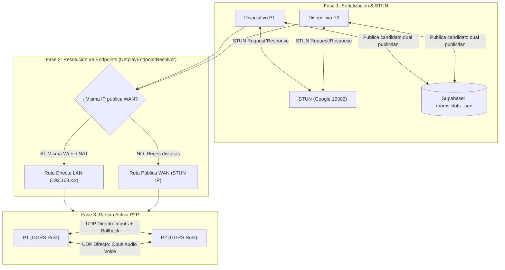
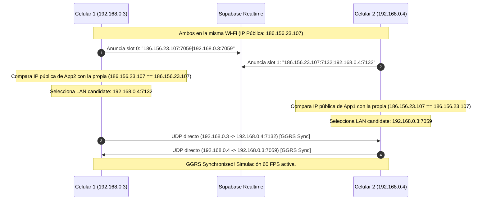

# Arquitectura Netplay P2P y Resolución de Red (bald.dog ARCADE)

Este documento detalla la arquitectura de red multijugador peer-to-peer (P2P), el ciclo de vida de sincronización de rollback (GGRS), la resolución dinámica de candidatos ante limitaciones de NAT Hairpinning en routers hogareños y los protocolos de diagnóstico para la resolución de incidentes.

---

## 1. Visión General de la Topología

bald.dog ARCADE utiliza una topología **P2P distribuida con señalización centralizada**:
- **Señalización (Lobby y Emparejamiento):** Supabase (PostgreSQL + Realtime WebSockets) gestiona la creación de salas, estado de preparación (`is_ready`) e intercambio de candidatos de red (`slots_json`).
- **Descubrimiento de IP Pública (STUN):** Servidor STUN estándar de Google (`stun.l.google.com:19302`) para resolver la dirección IP pública y puerto asignado por el router NAT de cada jugador.
- **Rollback Netplay (Entradas de Juego):** [GGRS](https://github.com/recallsingularity/ggrs) corriendo en el backend nativo en Rust (`rust/balddog-netplay`), enviando paquetes UDP directos de entrada con sincronización de estado y predicción determinista de fotogramas.
- **Canal de Voz (Baja Latencia):** Audio full-duplex con códec Opus (`rust/balddog-android` y `Oboe`/AAudio) transmitido por sockets UDP independientes.



---

## 2. El Problema del NAT Hairpinning (NAT Loopback)

### Causa Raíz
Cuando dos jugadores se encuentran físicamente en la misma red local (ej. ambos conectados a la misma Wi-Fi hogareña) y juegan en modo Online:
1. Ambos clientes resuelven la **misma dirección IP pública WAN** a través de STUN (ej. `186.156.23.107`).
2. Si los clientes envían paquetes UDP dirigidos a la IP pública externa del router:
   - Dispositivo 1 (`192.168.0.3`) envía paquete a `186.156.23.107:7132`.
   - El router recibe en su interfaz LAN un paquete con destino a su propia interfaz WAN.
3. La gran mayoría de routers comerciales residenciales **NO implementan NAT Hairpinning (NAT Loopback)**:
   - Descartan silenciosamente el paquete (drop).
   - O intentan enrutarlo hacia el ISP, donde es rechazado.

### Consecuencia en GGRS
- GGRS inicia siempre en `SessionState::Synchronizing`, intercambiando una ráfaga de paquetes UDP para acordar sincronización de reloj y cálculo de RTT.
- Sin NAT Hairpinning, **ningún paquete UDP llega al otro dispositivo**.
- GGRS permanece bloqueado indefinidamente en `SessionState::Synchronizing`.
- Como consecuencia, el ciclo de emulación Libretro (`core.take_video_frame()`) nunca ejecuta un solo fotograma de video, provocando que la pantalla quede completamente negra.

---

## 3. Solución Implementada: Candidatos Duales y Resolución ICE-like

Para resolver este problema sin obligar a los usuarios a activar configuraciones complejas en sus routers o cambiar manualmente a modo LAN, bald.dog ARCADE implementa una selección de candidatos estilo ICE:

### Formato de Candidato Dual
Al interactuar con STUN y la red local, cada dispositivo compone una cadena con ambos candidatos separados por un pipe (`|`):
```text
<public_stun_ip>:<public_port>|<local_lan_ip>:<local_port>
```
*Ejemplo:* `186.156.23.107:7059|192.168.0.3:7059`

Este formato se aplica tanto para el socket del juego (`endpoint`) como para el canal de voz (`voice_endpoint`).

### Algoritmo de Resolución (`NetplayEndpointResolver.kt`)
Al momento de lanzar la partida o medir ping entre pares:

```kotlin
fun resolveEffectiveEndpoint(peerEndpoint: String, myPublicIp: String?): String {
    val trimmed = peerEndpoint.trim()
    if (!trimmed.contains('|')) return trimmed // Compatibilidad con clientes legacy

    val parts = trimmed.split('|')
    val publicEp = parts[0].trim()
    val lanEp = parts.getOrNull(1)?.trim()

    val peerHost = publicEp.substringBefore(':').trim().removeSurrounding("[", "]")
    val myHost = myPublicIp?.substringBefore('|')?.substringBefore(':')?.trim()?.removeSurrounding("[", "]")

    // Si ambos comparten la IP pública WAN, conmutar a la IP LAN privada directa
    if (!myHost.isNullOrBlank() && peerHost == myHost && !lanEp.isNullOrBlank()) {
        return lanEp
    }
    // En caso contrario (redes distintas), usar el endpoint público STUN
    return publicEp
}
```



---

## 4. Ciclo de Vida de Sincronización GGRS y Renderizado

En `rust/balddog-core/src/session.rs`, el bucle de emulación multijugador sigue una máquina de estados estricta:

1. **`SessionState::Synchronizing`:**
   - Se procesan los eventos `GgrsEvent::Synchronizing { addr, total, count }`.
   - Se emite un log informativo cada 2 segundos con el progreso de sincronización.
   - **IMPORTANTE:** Durante esta fase **NO** se llama a `p2p.advance_frame()`, por lo que el core libretro no avanza fotogramas y la pantalla no debe desbloquearse prematuramente.
2. **`SessionState::Running`:**
   - Se recibe el evento `GgrsEvent::Synchronized { addr }`.
   - Se desbloquea el overlay de carga en la UI (`netplaySynchronized = true`).
   - El bucle llama a `p2p.advance_frame()` y luego a `core.take_video_frame()`, renderizando los primeros gráficos del juego.
3. **`GgrsEvent::NetworkInterrupted` / `NetworkResumed`:**
   - Manejo transparente de fluctuaciones temporales de red con temporizador de reconexión.
4. **`GgrsEvent::Disconnected`:**
   - Cierre limpio de la sesión informando el motivo del corte.

---

## 5. Guía de Diagnóstico y Depuración Rápida

Cuando se reporte un problema de conexión en salas multijugador ("pantalla en negro" o "tiempo de espera agotado"):

### Paso 1: Consultar los Endpoints en Supabase
Ejecutar la consulta contra `public.rooms` para inspeccionar los slots y endpoints anunciados:
```bash
python3 -c "
import urllib.request, json, re
props = dict(re.findall(r'^([^#=]+)=(.*)$', open('local.properties').read(), re.M))
req = urllib.request.Request(
    f'https://api.supabase.com/v1/projects/{props[\"SUPABASE_PROJECT_ID\"]}/database/query',
    data=json.dumps({'query': 'SELECT id, status, mode, slots_json FROM public.rooms ORDER BY created_at DESC LIMIT 1;'}).encode('utf-8'),
    headers={'Authorization': f'Bearer {props[\"SUPABASE_ACCESS_TOKEN\"]}', 'Content-Type': 'application/json'}
)
with urllib.request.urlopen(req) as resp:
    print(json.dumps(json.loads(resp.read().decode('utf-8')), indent=2))
"
```
**Qué verificar:**
- Que cada slot tenga un endpoint con candidato dual: `"endpoint": "<wan_ip>:<port>|<lan_ip>:<port>"`.
- Si falta el separador `|`, uno de los dispositivos está ejecutando un APK desactualizado.

### Paso 2: Inspeccionar Logs de GGRS en Android (`adb logcat`)
Con el celular conectado por USB:
```bash
adb logcat -d | grep -E "GGRS|startNetplayGame|onLaunchNetplayMatch|BaldDogNetplay"
```
**Líneas esperadas en una sesión saludable:**
```text
I BaldDogNetplay: onLaunchNetplayMatch: room=..., peerAddrs=[192.168.0.4:7132], localPort=7059
I balddog: GGRS Synchronizing 192.168.0.4:7132: 1/10
I balddog: GGRS Synchronizing 192.168.0.4:7132: 10/10
I balddog: GGRS Synchronized con par 192.168.0.4:7132! Partida iniciando simulación
I balddog: Primer frame de emulación renderizado: 384x224
```

### Paso 3: Matriz de Pruebas Recomendadas
- **Prueba 1 (Misma Wi-Fi):** Ambos celulares en la misma red local. Verifica que el resolver seleccione automáticamente los candidatos LAN (`192.168.x.x`).
- **Prueba 2 (Redes Cruzadas):** Un celular en Wi-Fi y otro en Datos Móviles (4G/5G). Verifica que el resolver seleccione los endpoints públicos STUN (WAN).

---

## Emparejamiento Rápido, Relleno de Salas, Baneos y Links Mágicos (`048`)

1. **Cola atómica y relleno (`find_or_enqueue_match`):**
   - Prioriza el relleno (*backfill*) de salas públicas en `waiting` con actividad reciente (`< 2 min`), excluyendo salas donde el usuario esté en `banned_user_ids` y ordenando por `player_count DESC, created_at ASC` con `FOR UPDATE SKIP LOCKED`.
   - Si no hay sala disponible, empareja al usuario con otro jugador activo en `public.matchmaking_queue` (`< 90 s` desde el último heartbeat) o realiza upsert de 1 búsqueda activa por `user_id`.
2. **Promoción automática de anfitrión y cierre de salas vacías (`update_room_slot`):**
   - Al salir el anfitrión (`leave`) en `waiting`, promueve al siguiente jugador sentado como `host_id` y `ready = true`. Si la sala queda con 0 jugadores, pasa automáticamente a `closed`.
3. **Baneo por sala (`ban_room_player`):**
   - Solo el anfitrión puede banear jugadores en `waiting`, eliminando su slot, borrando sus `room_messages` en esa sala y bloqueando su reingreso mediante `banned_user_ids`.
4. **Métricas en vivo (`get_matchmaking_stats`) y Links Mágicos (`get_public_open_rooms`):**
   - `MainShellScreen` consulta `get_matchmaking_stats()` cada 12s en la pestaña Salas.
   - `AndroidManifest.xml` y `MainActivity` soportan Android App Links (`https://bald.dog/room/<uuid>` y `balddog://room/<uuid>`) validados con `MatchmakingPolicy`.
   - `RoomLobbyScreen` descarga automáticamente BIOS + ROM en segundo plano mostrando una barra de avance en el botón **"MARCAR LISTO"**.
