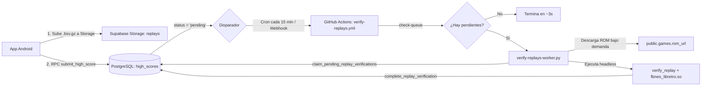

# Verificación Automática de Replays (Anti-Cheat)

Este documento describe la arquitectura, el ciclo de vida, las garantías de integridad y la operación del sistema de verificación determinista de replays `.bsv.gz` en **bald.dog ARCADE**.

---

## 1. Propósito y Principio de Diseño

El sistema de rankings competitivos de **bald.dog ARCADE** se basa en la regla **1CC (One Credit Clear)**: los puntajes válidos deben lograrse con **un solo crédito**, sin *save states* ni alteraciones de memoria.

Dado que el cliente Android no es un entorno confiable (un atacante podría modificar el APK o interceptar peticiones HTTP), **ningún cliente puede marcar un puntaje como `verified`**. La certificación ocurre exclusivamente en un entorno **headless en servidor** (actualmente mediante GitHub Actions) que reproduce los inputs grabados desde cero y audita la memoria RAM frame a frame.

---

## 2. Arquitectura y Flujo Completo

---

## 3. Estados de Verificación (`verification_status`)

La columna `public.high_scores.verification_status` admite 6 estados:

| Estado | Significado | Quién lo asigna |
| :--- | :--- | :--- |
| `unverified` | Puntaje enviado sin archivo replay adjunto. | `submit_high_score` |
| `pending` | Puntaje enviado con replay `.bsv.gz`, en espera de auditoría. | `submit_high_score` |
| `verifying` | Reclamado por un worker activo (`verification_claimed_at`). Si pasan >30 min sin completarse, vuelve a ser elegible. | `claim_pending_replay_verifications` |
| `verified` | Replay auditado exitosamente: hashes, CRC32, 1CC y puntaje coinciden exactamente. | `complete_replay_verification` |
| `rejected` | Falló alguna regla anti-cheat (`multiple_credits_detected`, `score_mismatch`, `replay_sha256_mismatch`, etc.). Se excluye del ranking. | `complete_replay_verification` |
| `error` | Fallo operativo del worker (ej. ROM faltante, timeout, error al cargar core). | `complete_replay_verification` |

---

## 4. Criterios de Auditoría (`verify_replay`)

El binario Rust [verify_replay.rs](file:///media/carlos/DATA1/DEV/Balddog-Android-App/rust/balddog-core/src/bin/verify_replay.rs) ejecuta la partida sin video ni audio bajo las siguientes reglas estrictas:

1. **Integridad criptográfica:**
   - El worker verifica que el `SHA-256` de la ROM y del `.bsv.gz` descargado coincidan con los registrados.
   - `ReplayPlayer::from_gzip_file_strict` valida el `CRC32` de la ROM, aplica un límite de descompresión de 16 MiB y rechaza replays con `state_size > 0`.
2. **Determinismo de emulación:**
   - Limpia la NVRAM (`clear_deterministic_nvram`) antes de arrancar.
   - Usa `fbneo_libretro.so` compilado con el **mismo commit fijado** (`5f6bdff9451d5c3dedd3d992d7412660eb202cf4`) y flags deterministas (`-fno-fast-math -ffp-contract=off`, `USE_CYCLONE=0`, `HAVE_NEON=0`) que la app Android.
3. **Control 1CC (`CoinTracker`):**
   - Monitorea `RETRO_COIN_MASK` durante toda la sesión. Si `coins_inserted > 1`, rechaza con `multiple_credits_detected`.
4. **Evaluación de RAM (`rcheevos`):**
   - Evalúa `g.score_config->>'lboard'` en cada frame y compara `verified_score` contra `claimed_score`. Si difieren, rechaza con `score_mismatch`.

---

## 5. Operación en GitHub Actions

El workflow [verify-replays.yml](file:///media/carlos/DATA1/DEV/Balddog-Android-App/.github/workflows/verify-replays.yml) se ejecuta en `ubuntu-latest`:
- **Disparadores:**
  - `schedule`: cada 15 minutos (`*/15 * * * *`).
  - `workflow_dispatch`: ejecución manual desde la pestaña **Actions** (permite indicar `batch_size`).
  - `repository_dispatch` (`types: [verify-replays]`): disparo instantáneo opcional desde un Database Webhook de Supabase.
- **Optimización:** El job `check-queue` consulta si hay registros en `pending` o `verifying` antes de levantar Rust o restaurar cachés. Si la cola está vacía, termina en ~3 segundos.
- **Secretos requeridos en GitHub:**
  - `SUPABASE_URL`
  - `SUPABASE_SERVICE_ROLE_KEY`

---

## 6. Evolución y Escalabilidad Futura

- **Corto/Mediano plazo:** GitHub Actions + caché de `fbneo_libretro.so`, `verify_replay` y ROMs descargadas bajo demanda cubre el volumen actual a costo cero.
- **Alto volumen:** Si la cola supera la capacidad de un cron cada 15 min, `scripts/verify-replays-worker.py` está listo para desplegarse como contenedor Docker en **Google Cloud Run Jobs** o en una VM **Oracle Cloud Always Free** sin cambiar la lógica de base de datos ni de Rust.
